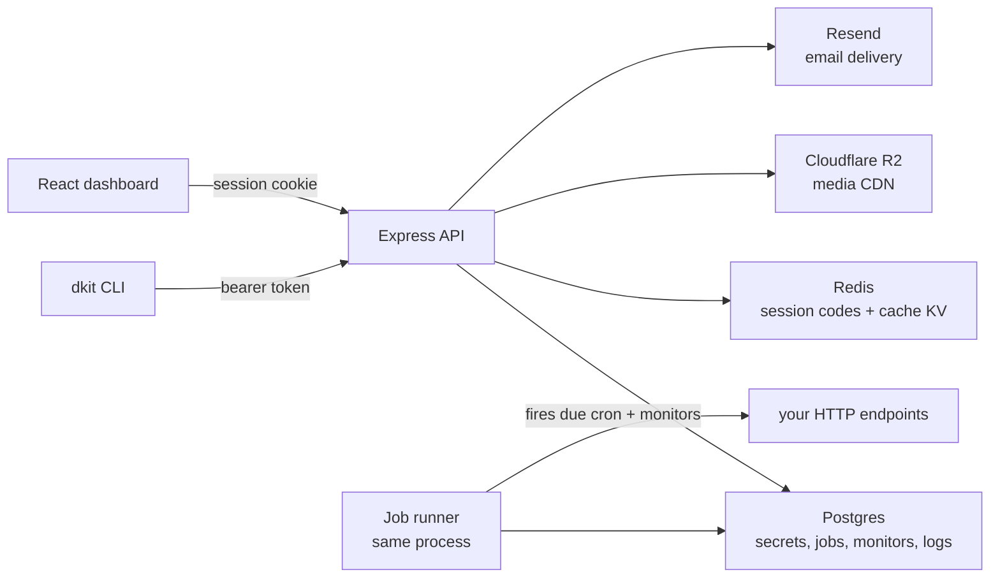

<p align="center">
  
</p>

<h1 align="center">Dkit</h1>

<p align="center"><strong>Secrets and runtime config for small teams. Per-environment values, encrypted at rest, injected at runtime. Self-hosted, one CLI, one dashboard, one API.</strong></p>

<p align="center">
  
  
  
  
  
  
</p>

---

Dkit replaces the `.env` file you copy between machines, paste into chat, and eventually commit by mistake. Values live per project and environment, are encrypted at rest, and are injected into your process when it starts. The `dkit` CLI, the React dashboard, and the plain HTTP API all talk to the same backend.

```bash
curl -fsSL https://dkit.name.ng/install.sh | sh
```

Checksum-verified download, needs only curl, tar and node. The CLI talks to `https://dkit.name.ng` by default; set `DKIT_API_URL` to point it at a self-hosted API.

## Self-host it

```bash
git clone https://github.com/sera0x/Dkit.git
cd Dkit
cp backend/.env.example backend/.env   # fill in the four required values
(cd backend && npm install)
(cd website && npm install && npm run build)
(cd backend && node src/server.js)
```

That brings up the API and the dashboard on `localhost:3001`. The schema creates itself on first boot. You need Node 18+, PostgreSQL and Redis, plus:

| Variable | What it is |
|---|---|
| `DB_PASSWORD` | Password for the `dkituser` Postgres role |
| `JWT_SECRET` | Signs session tokens — `openssl rand -hex 32` |
| `DKIT_ENCRYPTION_KEY` | Encrypts env values, env history and TOTP secrets — `openssl rand -hex 32` |
| `RESEND_API_KEY` | Sends verification codes, invites and uptime alerts |

OAuth (Google, GitHub) stays hidden until both ID and secret are set. Media uploads need Cloudflare R2 credentials (`R2_ACCOUNT_ID`, `R2_ACCESS_KEY_ID`, `R2_SECRET_ACCESS_KEY`, `R2_BUCKET`); everything else works without them. Back up Postgres and `DKIT_ENCRYPTION_KEY` together: without both, stored secrets cannot be recovered.

Set `PUBLIC_URL` in `backend/.env` to your public origin, and build the dashboard with `VITE_SITE_URL` set to the same origin, so OAuth callbacks, invite links and canonical URLs agree. Without `VITE_SITE_URL` the dashboard uses the origin it is served from. A minimal Cloudflare Tunnel ingress is in [`deploy/cloudflared/config.example.yml`](deploy/cloudflared/config.example.yml).

## What it does

- **Secrets are encrypted at rest.** Env values, env history and TOTP secrets are AES-256-GCM encrypted with `DKIT_ENCRYPTION_KEY`. API keys and refresh tokens are SHA-256 hashes; the plaintext exists only in the response that issued them. Env listings are masked server-side; `env:get` reveals one value, and the history API returns value lengths instead of values.
- **Environments are first-class.** `development`, `staging`, `production`, or your own names — separate secret sets per project. `env:diff`, `env:copy`, `env:rollback <key>`.
- **No `.env` on disk.** `dkit run -- npm start` injects secrets into the child process and exits with its status. `env:pull > .env` exists when you do want the file.
- **Browser sessions stay out of JavaScript.** The refresh token lives in an httpOnly, SameSite=Lax cookie scoped to `/api/auth`; the access token stays in memory. Refresh and logout require a CSRF token, and the API sends a restrictive CSP. The CLI keeps using bearer tokens.
- **Teams.** Owner/admin/member roles, projects shared into a team, invitations that only work for a verified address.
- **Destructive actions type-to-confirm.** Projects and secrets confirm through a prompt, like a terminal.

Cron jobs, uptime monitors, log drain, a JSON key-value store, a Redis cache, and R2 media uploads are available from the same API and CLI. They are secondary to secrets; the full reference is at `/docs`.

## How it fits together

The CLI and the dashboard are two clients of the same API — neither is a special case. The backend serves the built dashboard and the API on one port; a job runner in the same process claims due cron jobs and probes monitors. Secrets live in Postgres per project and environment, and values only travel to clients that already passed the access check.



## Repository layout

| Path | What it is |
|---|---|
| `backend/` | Express API, job runner, auth flow — the entire backend |
| `website/` | React dashboard and marketing site, built with Vite |
| `cli/` | The `dkit` CLI, plus project templates for `dkit new` |
| `scripts/` | Development and test helpers |
| `install.sh` | The `curl \| sh` installer for the CLI |

## CLI

| Command | What it does |
|---|---|
| `dkit login` / `dkit logout` | Sign in with email + one-time code; revoke the device session |
| `dkit verify <code>` / `verify:send` / `verify:status` | Email verification from the terminal |
| `dkit new <name>` | Scaffold a project from a template and link this folder to it |
| `dkit projects:create <name>` | Create a project (keyless until a key is issued) |
| `dkit keys:rotate [name]` | Issue or replace the API key; old one stops immediately |
| `dkit env:set <key> <value>` / `env:get` / `env:list` | Set, read one, or list all (masked unless `--show`) |
| `dkit env:rollback <key>` / `env:history <key>` / `env:diff` / `env:copy` / `env:pull` / `env:push <file>` | History, audit feed, compare, sync, export, bulk-import |
| `dkit run -- <command>` | Run a command with secrets injected, nothing written to disk |
| `dkit store:set/get/incr` / `store:list` / `store:delete` | JSON store: values, TTL, atomic increments |
| `dkit kv:set/get/incr` / `kv:list` / `kv:del` / `kv:flush` | Redis cache: TTL strings, atomic counters, prefix listing |
| `dkit upload <files…>` / `files:list` / `files:url` / `files:rm` | Media CDN: upload, browse, resolve and delete files |
| `dkit share <file> --ttl 15m` | Self-destructing temporary link for screenshots and test payloads |
| `dkit cron:add <name> <url> -s "..."` / `cron:list` / `cron:runs` / `cron:run` / `cron:pause` / `cron:rm` | Schedule, inspect, run now, pause, delete |
| `dkit monitor:add <name> <url>` / `monitor:list` / `monitor:pause` / `monitor:rm` | Watch a URL; email on down and recovery |
| `dkit logs:ship` / `logs:tail` / `logs:clear` | Ship lines or JSON batches; tail with filters; delete all |
| `dkit 2fa status` / `setup` / `enable` / `disable` | Two-factor auth for your account |
| `dkit doctor [--fix]` | Diagnose the setup and apply the safe fixes |

Full reference lives at `/docs` on your deployment.

## Security, briefly

Env values, env history and TOTP secrets are AES-256-GCM encrypted at rest with `DKIT_ENCRYPTION_KEY`. API keys and refresh tokens are stored as SHA-256 hashes, and refresh tokens rotate on every use. Browser sessions use an httpOnly refresh cookie, an in-memory access token, and a double-submit CSRF token; the CLI keeps bearer auth. Responses carry a restrictive Content-Security-Policy, and CORS accepts only `PUBLIC_URL` plus local development origins. Env listings are masked server-side, the history API returns value lengths, and one-time codes and invitations are rate-limited.

## License

MIT — see [LICENSE](LICENSE). Security issues: see [SECURITY.md](SECURITY.md).
