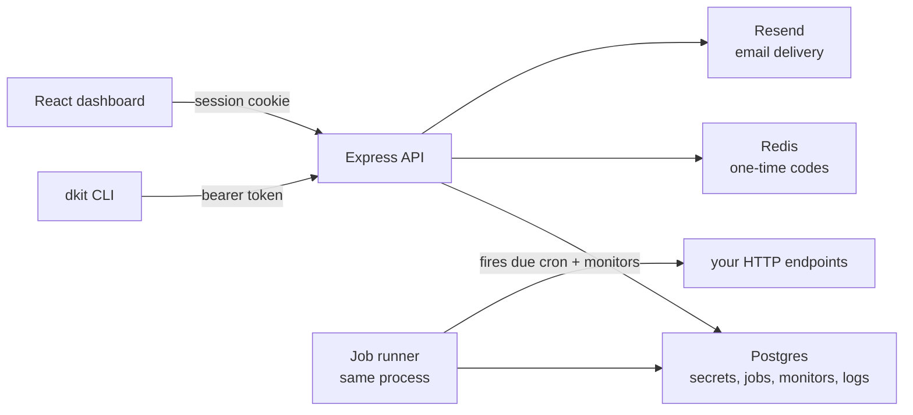

<p align="center">
  
</p>

<h1 align="center">Dkit</h1>

<p align="center"><strong>Secrets, cron jobs, uptime checks, a log drain, and a JSON store — one CLI, one dashboard, one API. Self-hosted.</strong></p>

<p align="center">
  
  
  
  
  
  
</p>

---

Dkit is the boring-infrastructure layer for side projects: secrets per environment, scheduled HTTP jobs, URL monitors that email you once when they go down, a place for apps to ship logs, and a small JSON store. The `dkit` CLI, the React dashboard, and the plain HTTP API all talk to the same backend.

```bash
curl -fsSL https://raw.githubusercontent.com/sera0x/Dkit/main/install.sh | sh
```

Checksum-verified download, needs only curl, tar and node. If Node is already in your stack: `npm install -g dkit-cli`.

## Self-host it

```bash
git clone https://github.com/sera0x/Dkit.git
cd Dkit
cp backend/.env.example backend/.env   # fill in the three required values
./scripts/start.sh
```

That brings up the API and the dashboard on `localhost:3001`. The schema creates itself on first boot. You need Node 18+, PostgreSQL and Redis, plus:

| Variable | What it is |
|---|---|
| `DB_PASSWORD` | Password for the `dkituser` Postgres role |
| `JWT_SECRET` | Signs session tokens — `openssl rand -hex 32` |
| `RESEND_API_KEY` | Sends verification codes, invites and uptime alerts |

OAuth (Google, GitHub) stays hidden until both ID and secret are set. A VPS checklist is in [VPS-SETUP.md](VPS-SETUP.md); moving the whole stack to a new box is one archive — see [MIGRATION.md](MIGRATION.md).

## What's in it

- **Secrets are hashed at rest.** API keys and refresh tokens are SHA-256 hashes; the plaintext exists only in the response that issued them. Env listings are masked server-side; `env:get` reveals one value, and env history keeps lengths instead of values.
- **Environments are first-class.** `development`, `staging`, `production`, or your own names — separate secret sets per project. `env:diff`, `env:copy`, `env:rollback <key>`.
- **No `.env` on disk.** `dkit run -- npm start` injects secrets into the child process and exits with its status. `env:pull > .env` exists when you do want the file.
- **Cron is human strings.** `30s`, `5m`, `daily 09:30`, `mon 09:00`, all UTC, 10-second floor. The API fires the HTTP calls, keeps run history, and can pause or run a job on demand.
- **Monitors email once.** One alert when a URL goes down, one when it recovers. Granularity from 30 seconds to an hour.
- **Log drain accepts anything that can POST.** Ship lines or JSON batches; tail with level and search filters; 7-day retention.
- **A JSON key-value store** with optional TTL and atomic increments — for state that isn't a secret.
- **Teams.** Owner/admin/member roles, projects shared into a team, invitations that only work for a verified address.
- **Destructive actions type-to-confirm.** Projects and secrets confirm through a prompt, like a terminal.

## How it fits together

The CLI and the dashboard are two clients of the same API — neither is a special case. The backend serves the built dashboard and the API on one port; a job runner in the same process claims due cron jobs and probes monitors. Secrets live in Postgres per project and environment, and values only travel to clients that already passed the access check.



## Repository layout

| Path | What it is |
|---|---|
| `backend/` | Express API, job runner, auth flow — the entire backend |
| `website/` | React dashboard and marketing site, built with Vite |
| `cli/` | The `dkit` CLI, plus project templates for `dkit new` |
| `scripts/` | Start, update, preview and VPS migration scripts |
| `install.sh` | The `curl \| sh` installer for the CLI |
| `VPS-SETUP.md` | Step-by-step VPS setup checklist |
| `MIGRATION.md` | How to move everything to a new VPS with one archive |

## CLI

| Command | What it does |
|---|---|
| `dkit login` / `dkit logout` | Sign in with email + one-time code; revoke the device session |
| `dkit verify <code>` / `verify:send` / `verify:status` | Email verification from the terminal |
| `dkit new <name>` | Scaffold a project from a template and link this folder to it |
| `dkit projects:create <name>` | Create a project (keyless until a key is issued) |
| `dkit keys:rotate [name]` | Issue or replace the API key; old one stops immediately |
| `dkit env:set <key> <value>` / `env:get` / `env:list` | Set, read one, or list all (masked unless `--show`) |
| `dkit env:rollback <key>` / `env:history <key>` / `env:diff` / `env:copy` / `env:pull` / `env:push <file>` | History, audit feed, compare, sync, export, bulk-import |
| `dkit run -- <command>` | Run a command with secrets injected, nothing written to disk |
| `dkit store:set/get/incr` / `store:list` / `store:delete` | JSON store: values, TTL, atomic increments |
| `dkit cron:add <name> <url> -s "..."` / `cron:list` / `cron:runs` / `cron:run` / `cron:pause` / `cron:rm` | Schedule, inspect, run now, pause, delete |
| `dkit monitor:add <name> <url>` / `monitor:list` / `monitor:pause` / `monitor:rm` | Watch a URL; email on down and recovery |
| `dkit logs:ship` / `logs:tail` / `logs:clear` | Ship lines or JSON batches; tail with filters; delete all |
| `dkit 2fa status` / `setup` / `enable` / `disable` | Two-factor auth for your account |
| `dkit doctor [--fix]` | Diagnose the setup and apply the safe fixes |

Full reference lives at `/docs` on your deployment.

## Security, briefly

API keys and refresh tokens are stored as SHA-256 hashes; refresh tokens rotate on every use. Env listings are masked server-side, env history keeps value lengths, and one-time codes and invitations are rate-limited.

## License

MIT — see [LICENSE](LICENSE).
